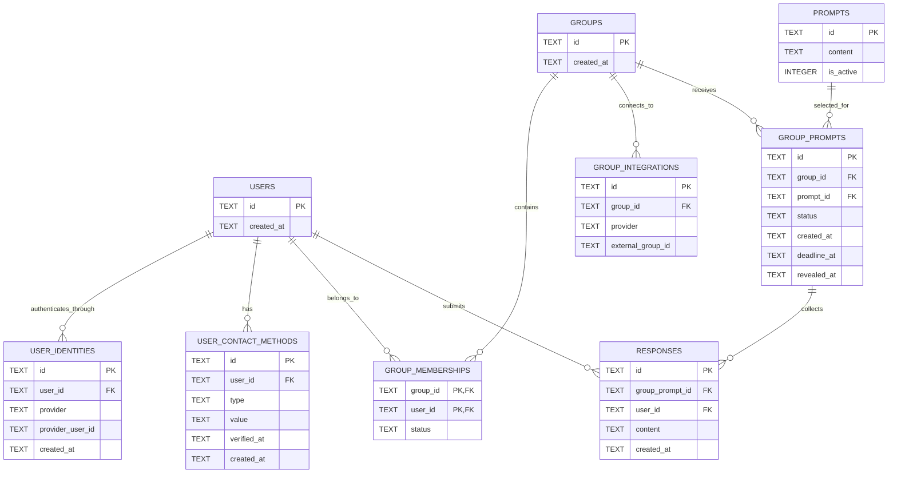

# Tiny Cosmos — Database Schema (v4)

**Status:** Initial platform schema for the Telegram-first MVP  
**Database:** SQLite  
**Migration:** `database/migrations/001_initial_schema.sql`  
**Last updated:** 2026-11-20

This document describes the initial relational model for Tiny Cosmos. The MVP will be experienced through Telegram, but the database is designed around native Tiny Cosmos users and groups so Flutter, web, SMS, and other interfaces can be added without making Telegram the foundation of the product.

---

## 1. Architectural principles

### Tiny Cosmos owns identity

A `users` row represents a Tiny Cosmos account. Telegram, Apple, Google, email, and phone-based authentication are identities that may be linked to that account; they are not the account itself.

A user can start in Telegram and later link another login method without changing their Tiny Cosmos user ID or losing their group history.

### Tiny Cosmos owns groups

A `groups` row represents a native Tiny Cosmos group. An external platform such as Telegram is connected through `group_integrations`.

A Telegram group does not become a Tiny Cosmos group merely because the bot is added. A group is created in Tiny Cosmos only after an authorized person explicitly activates it.

### Interfaces are adapters

Telegram, SMS, Flutter, and web are different ways to interact with the same users, groups, prompts, responses, and future cosmos. Business rules should live in the shared application layer, not be independently reimplemented in each interface.

### Keep the MVP narrow

The schema accommodates future authentication and interfaces, but the MVP does not need to implement account registration, Apple/Google sign-in, SMS authentication, or a web/mobile client. Telegram interactions can create a Tiny Cosmos user and a Telegram identity automatically.

---

## 2. MVP product rules represented by the schema

1. One Tiny Cosmos user may have multiple external authentication identities.
2. A given provider identity can belong to only one Tiny Cosmos user.
3. Contact destinations such as email addresses and phone numbers are stored separately from authentication identities and can be marked verified.
4. A Tiny Cosmos group is created only after explicit activation.
5. External group connections are stored separately from the native group.
6. Membership is represented by a many-to-many relationship between users and groups.
7. Membership rows are retained when a member leaves. The status changes to `left`; rejoining changes it to `active`.
8. A prompt is a reusable library entry. A group prompt is a particular distribution of that prompt to one group.
9. A group must never receive the same prompt twice. Different groups may receive the same prompt.
10. A user may submit at most one response per group prompt. Responses are immutable in the MVP.
11. Only active members may submit responses. The application checks membership before accepting a response.
12. Responses remain hidden until a predetermined reveal deadline.
13. The deadline is calculated when the prompt is distributed and stored on the group prompt. It is 24 hours before the next global prompt distribution.
14. Membership changes do not move the deadline. At reveal time, only responses from users who are currently active members are included.
15. If someone leaves and rejoins before reveal, their original response becomes eligible again because membership is checked at reveal time.
16. A distribution is revealed at its deadline even if nobody responded. An empty reveal receives an encouraging message rather than being treated as an error.
17. A completed reveal is not undone by later membership changes.

---

## 3. Entity relationship diagram



---

## 4. Tables

### `users`

One row per Tiny Cosmos account.

| Column | Type | Rules | Purpose |
|---|---|---|---|
| `id` | TEXT | Primary key | Internal UUID |
| `created_at` | TEXT | Required, default UTC timestamp | Account creation time |

The internal user ID is the stable identifier used by all Tiny Cosmos relationships. It does not depend on Telegram or any other provider.

### `user_identities`

External authentication identities linked to Tiny Cosmos accounts.

| Column | Type | Rules | Purpose |
|---|---|---|---|
| `id` | TEXT | Primary key | Internal UUID |
| `user_id` | TEXT | Required, foreign key | References `users.id` |
| `provider` | TEXT | Required; constrained to supported initial values | Identity provider |
| `provider_user_id` | TEXT | Required | Stable identifier from that provider |
| `created_at` | TEXT | Required, default UTC timestamp | When the identity was linked |

The pair `(provider, provider_user_id)` is unique. For example, the same Telegram account cannot accidentally create two Tiny Cosmos accounts.

Initial provider values allowed by the migration are `telegram`, `email`, `apple`, `google`, and `phone`. The MVP only needs the Telegram path. Adding a new provider later may require a migration to expand the check constraint.

For email identities, the application should normalize the email address consistently before storing it. For Apple and Google, use the stable provider subject/user identifier, not a display name.

**Account-linking security:** Do not automatically merge accounts merely because two providers return the same email address. Linking should require proof of control of the existing Tiny Cosmos account and the new identity.

### `user_contact_methods`

Destinations used to communicate with a user. A contact method is not automatically an authentication identity.

| Column | Type | Rules | Purpose |
|---|---|---|---|
| `id` | TEXT | Primary key | Internal UUID |
| `user_id` | TEXT | Required, foreign key | References `users.id` |
| `type` | TEXT | Required; `email` or `phone` | Contact method type |
| `value` | TEXT | Required | Email address or phone number |
| `verified_at` | TEXT | Nullable | When ownership was verified |
| `created_at` | TEXT | Required, default UTC timestamp | When the contact method was added |

`UNIQUE (type, value)` prevents the same normalized contact destination from being attached to multiple accounts. The application should normalize email addresses and phone numbers before storing them. A contact method is not considered verified until `verified_at` is populated.

### `groups`

One row per native Tiny Cosmos group.

| Column | Type | Rules | Purpose |
|---|---|---|---|
| `id` | TEXT | Primary key | Internal UUID |
| `created_at` | TEXT | Required, default UTC timestamp | When the Tiny Cosmos group was created |

There are intentionally no Telegram-specific fields here. A group can exist independently of any external platform.

For the MVP, a group record is created only after an authorized Telegram group administrator explicitly activates Tiny Cosmos.

### `group_integrations`

Connections between a Tiny Cosmos group and an external platform group.

| Column | Type | Rules | Purpose |
|---|---|---|---|
| `id` | TEXT | Primary key | Internal UUID |
| `group_id` | TEXT | Required, foreign key | References `groups.id` |
| `provider` | TEXT | Required | Platform, such as `telegram` |
| `external_group_id` | TEXT | Required | Group identifier on that platform |

`UNIQUE (provider, external_group_id)` prevents the same external group from being connected to multiple Tiny Cosmos groups.

### `group_memberships`

The many-to-many relationship between users and groups.

| Column | Type | Rules | Purpose |
|---|---|---|---|
| `group_id` | TEXT | Required, part of composite primary key, foreign key | References `groups.id` |
| `user_id` | TEXT | Required, part of composite primary key, foreign key | References `users.id` |
| `status` | TEXT | Required; `active` or `left` | Current membership state |

The composite primary key `(group_id, user_id)` means a user has at most one membership record per group.

Rows are retained when people leave. On leave, update the status to `left`; on rejoin, update the same row to `active`. This lets a returning member's earlier response become eligible again before a prompt is revealed.

### `prompts`

The reusable prompt library. A row describes a prompt, not a particular distribution.

| Column | Type | Rules | Purpose |
|---|---|---|---|
| `id` | TEXT | Primary key | Internal UUID |
| `content` | TEXT | Required | Prompt text |
| `is_active` | INTEGER | Required; 0 or 1 | Whether the prompt can be selected for future distributions |

A prompt can be deactivated without deleting it or breaking historical `group_prompts` records.

### `group_prompts`

One row per prompt distribution to a group.

| Column | Type | Rules | Purpose |
|---|---|---|---|
| `id` | TEXT | Primary key | Internal UUID |
| `group_id` | TEXT | Required, foreign key | Group receiving the prompt |
| `prompt_id` | TEXT | Required, foreign key | Reusable prompt being distributed |
| `status` | TEXT | Required; `collecting` or `revealed` | Distribution lifecycle |
| `created_at` | TEXT | Required, default UTC timestamp | When the distribution record was created |
| `deadline_at` | TEXT | Required | Predetermined reveal deadline |
| `revealed_at` | TEXT | Nullable | Actual time reveal was completed |

`UNIQUE (group_id, prompt_id)` enforces the no-repeat rule for each group.

A check constraint requires `revealed_at` to be null while status is `collecting`, and non-null when status is `revealed`. The application must update both fields together when completing a reveal.

### `responses`

One row per user's response to a particular group prompt.

| Column | Type | Rules | Purpose |
|---|---|---|---|
| `id` | TEXT | Primary key | Internal UUID |
| `group_prompt_id` | TEXT | Required, foreign key | The distribution being answered |
| `user_id` | TEXT | Required, foreign key | User who submitted the response |
| `content` | TEXT | Required | Response text |
| `created_at` | TEXT | Required, default UTC timestamp | Submission time |

`UNIQUE (group_prompt_id, user_id)` ensures that a user can submit only one response to a particular distribution.

The schema references the user and distribution, but does not by itself prove that the user belongs to the distribution's group. The application checks that the user has an active membership in the relevant group before accepting a response.

Responses are immutable in the MVP: the application should not expose an edit operation.

---

## 5. Constraints and indexes

### Important constraints

| Constraint | Example | What it protects |
|---|---|---|
| Primary key | `users.id` | Unique record identity |
| Unique | `user_identities(provider, provider_user_id)` | One Tiny Cosmos account per external identity |
| Unique | `user_contact_methods(type, value)` | A normalized contact destination belongs to at most one account |
| Unique | `group_integrations(provider, external_group_id)` | An external group is connected only once |
| Composite primary key | `group_memberships(group_id, user_id)` | No duplicate membership rows |
| Composite unique | `group_prompts(group_id, prompt_id)` | No repeated prompt for a group |
| Composite unique | `responses(group_prompt_id, user_id)` | No duplicate response |
| Foreign key | `responses.user_id` | No response for a nonexistent user |
| Check | Membership status | Only supported membership states |
| Check | Prompt active flag | Only 0 or 1 |
| Check | Distribution status/timestamp | Consistent reveal state |

### Indexes created by the migration

| Index | Columns | Purpose |
|---|---|---|
| `idx_user_identities_user_id` | `user_id` | Find identities linked to an account |
| `idx_user_contact_methods_user_id` | `user_id` | Find contact methods for an account |
| `idx_group_integrations_group_id` | `group_id` | Find external integrations for a group |
| `idx_group_memberships_group_status` | `(group_id, status)` | Find active members in a group |
| `idx_group_prompts_status_deadline` | `(status, deadline_at)` | Find distributions due for reveal |
| `idx_responses_user_id` | `user_id` | Find a user's response history |

Primary keys and unique constraints also create indexes in SQLite.

### SQLite foreign keys

Foreign-key enforcement must be enabled on every database connection:

```sql
PRAGMA foreign_keys = ON;
```

This setting is connection-specific. Running it in the migration file does not permanently enable it for future application connections. Configure the SQLite driver/connection appropriately and verify the behavior in the Go application.

---

## 6. Application responsibilities

### Telegram user provisioning

When a user interacts with the bot:

1. Read the Telegram user ID from the authenticated Telegram update.
2. Find `user_identities` where `provider = 'telegram'` and `provider_user_id` matches.
3. If found, use its `user_id` to load the Tiny Cosmos user.
4. If not found, create a `users` row and a corresponding `user_identities` row in one transaction.
5. Use the internal Tiny Cosmos user ID for all subsequent relationships.

No formal registration screen is required for the Telegram MVP.

### Group activation

Adding the bot to a Telegram group does not itself create a Tiny Cosmos group.

When an authorized group administrator activates Tiny Cosmos:

1. Verify the activation request and the administrator's authority with Telegram.
2. Create the native `groups` row.
3. Create its `group_integrations` row with provider `telegram` and the Telegram chat ID.
4. Begin membership synchronization and onboarding.
5. Make the group eligible for prompt distribution when the activation workflow is complete.

Create the group and integration records in a transaction. The unique integration constraint protects against duplicate activation of the same Telegram group.

**Telegram membership synchronization caveat:** Telegram bots generally cannot request a complete list of all current group members on demand. Do not assume that the bot can enumerate and import every existing member during activation. Design onboarding around the members the bot can observe, such as users who interact or whose membership updates are delivered, and make the synchronization behavior explicit in the product.

### Membership synchronization

Use Telegram membership updates to create or update `group_memberships` rows. On leave, set status to `left`; on rejoin, set it to `active`.

### Response submission

Before inserting a response:

1. Confirm the group prompt exists and is still collecting responses.
2. Find the group associated with that group prompt.
3. Confirm the submitting user has an active membership in that group.
4. Insert the response.
5. Let the unique constraint reject a second response from the same user for that distribution.

### Reveal

A scheduled process finds group prompts whose `deadline_at` has passed and whose status is `collecting`.

For each due distribution:

1. Retrieve responses belonging to users whose membership status in that group is currently `active`.
2. Distribute those responses, or send the empty-week message if there are none.
3. Mark the distribution `revealed` and set `revealed_at`.

The reveal operation must be idempotent so retries do not distribute the same reveal twice. A database transaction cannot roll back a Telegram message already sent, so reliable external delivery may eventually call for an outbox or delivery-tracking mechanism. That operational mechanism is intentionally not part of this initial schema.

A later membership change does not reverse a completed reveal.

---

## 7. Timestamp convention

All timestamps are stored as ISO 8601 UTC text, for example:

`2026-11-23T18:30:00.000Z`

The migration uses SQLite's `strftime('%Y-%m-%dT%H:%M:%fZ', 'now')` expression for default creation timestamps. The Go application should use the same UTC representation when supplying `deadline_at` and other timestamps. Avoid mixing local timestamps, UTC timestamps, and different string formats.

---

## 8. Intentionally postponed

- **Authentication sessions:** Add when implementing real account login, session expiration, and revocation.
- **Verification challenges:** Add when implementing email/phone OTP flows.
- **Account recovery and account linking workflows:** Build when additional authentication providers are introduced.
- **Group onboarding status and settings:** Add when the actual onboarding steps and lifecycle states are defined.
- **Cosmos and celestial objects:** Future visual representation and group-history modeling are outside the current prompt/response MVP.
- **Global weekly schedule table:** Initially held in application configuration; each group's calculated deadline is persisted in `group_prompts.deadline_at`.
- **Response edit history:** Responses are immutable in the MVP.
- **Admin roles inside Tiny Cosmos:** Telegram admin authority is checked through Telegram for the Telegram MVP; a native role model can be introduced when needed.
- **Delivery outbox:** A future reliability mechanism for coordinating database state changes with external message delivery.

---

## 9. Local development and migrations

Migrations live in `database/migrations/` and are embedded into the Go binaries. The bot (`go run ./cmd/bot`) creates the database if needed and applies any new migrations on startup, tracking the applied version with `PRAGMA user_version`. Migration files must be named `NNN_description.sql`.

The migrator refuses to touch a database that has tables but no recorded version, such as one created by hand with the command below, because it can't tell which migrations that database already contains. Let the bot create the database instead, or delete a hand-made one before starting the bot.

To apply the schema by hand without the bot (for quick experiments only):

```bash
mkdir -p data
sqlite3 data/tiny-cosmos.db < database/migrations/001_initial_schema.sql
```

Inspect the schema:

```bash
sqlite3 data/tiny-cosmos.db
```

Then:

```sql
.tables
.schema user_identities
.schema group_prompts
```

Keep development seed data separate from schema migrations, for example in `database/seeds/development.sql`.

A development reset can delete the local database file and reapply all migrations. Clearly guard destructive reset scripts so they cannot accidentally target production data.

As the schema evolves, add numbered migrations such as `002_add_group_settings.sql`. Do not edit a migration that has already been applied to a database shared by other environments.

Add the local database file to `.gitignore`; commit migration and seed scripts, not the local database file.
